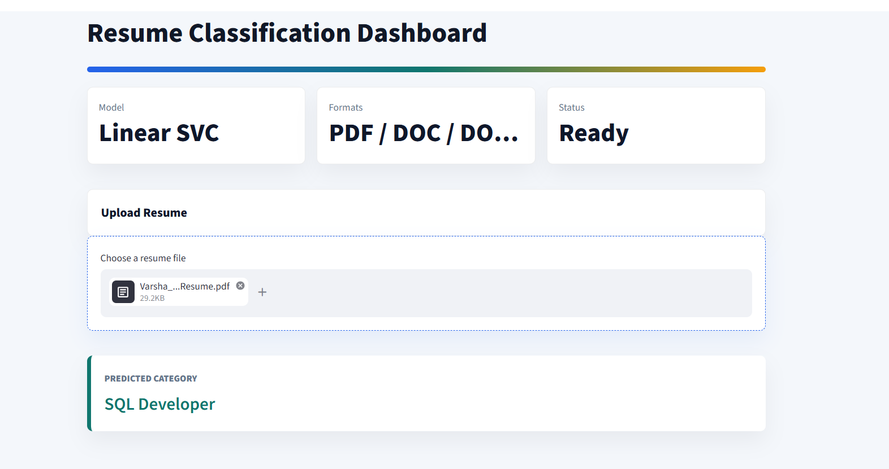

# Resume Classification System

## Project Overview
The Resume Classification System is an NLP and Machine Learning-based application that automatically classifies resumes into predefined job categories. It extracts text from uploaded resumes, applies NLP preprocessing, converts text into numerical features using TF-IDF, and predicts the appropriate category using a trained Machine Learning model.

## Application Screenshots

### Resume Classification Dashboard


### Resume Prediction Result




## Objectives
- Automate resume classification using Machine Learning.
- Apply NLP techniques to clean and process resume text.
- Compare multiple classification algorithms.
- Build an interactive application using Streamlit.

## Technologies Used
- **Programming Language:** Python
- **Machine Learning:** Scikit-learn
- **NLP:** NLTK
- **Feature Extraction:** TF-IDF
- **Models:** Logistic Regression, Multinomial Naive Bayes, Linear SVC
- **Deployment:** Streamlit
- **Libraries:** Pandas, NumPy, PDFPlumber, Python-docx

## Dataset
The project uses 77 resumes across four predefined categories:

- React Developer – 23 resumes
- Workday – 21 resumes
- PeopleSoft Resume – 19 resumes
- SQL Developer – 14 resumes

## Project Workflow
1. Resume data collection and text extraction.
2. Exploratory Data Analysis (EDA).
3. Text preprocessing using NLP techniques.
4. Feature extraction using TF-IDF.
5. Model training and evaluation.
6. Selection of the best-performing model.
7. Deployment using Streamlit.

## NLP Preprocessing
- Lowercase conversion
- URL and email removal
- Phone number removal
- HTML tag and punctuation removal
- Number removal
- Whitespace normalization
- Tokenization
- Stopword removal
- Lemmatization

## Model Performance

| Model | Accuracy |
|---|---:|
| Logistic Regression | 87.50% |
| Multinomial Naive Bayes | 93.75% |
| Linear SVC | 100% |

Linear SVC was selected as the final model based on its performance on the held-out test dataset.

**Note:** The test set contained only 16 resumes. The reported accuracy represents this particular test split and does not guarantee performance on unseen real-world resumes.

## Streamlit Application Features
- Upload resumes in PDF, DOCX, TXT and DOC formats.
- Extract text from uploaded resumes.
- Automatically preprocess resume text.
- Predict the resume category using the trained Linear SVC model.
- Display the predicted category through an interactive dashboard.

**Note:** Legacy DOC extraction on Windows requires Microsoft Word and the `pywin32` package.

## Project Files
- `app.py` – Streamlit application.
- `resume_project.ipynb` – Model development and analysis.
- `linear_svc_model.pkl` – Trained Linear SVC model.
- `tfidf_vectorizer.pkl` – Saved TF-IDF vectorizer.
- `label_encoder.pkl` – Saved label encoder.
- `Resume_Classification_Project_Presentation.pptx` – Project presentation.

## Installation and Execution

### 1. Clone the repository
```bash
git clone https://github.com/varsha-pabbathireddy/Resume-Classification-Project-2026.git
```

### 2. Navigate to the project folder
```bash
cd Resume-Classification-Project-2026
```

### 3. Install dependencies
```bash
pip install -r requirements.txt
```

### 4. Run the Streamlit application
```bash
python -m streamlit run app.py
```

## Future Enhancements
- Expand the dataset with more resume categories.
- Improve model generalization using larger and more diverse datasets.
- Add confidence scores for predictions.
- Improve resume parsing and text extraction.
- Support additional resume formats.

## Author
**Varsha Pabbathireddy**

GitHub: [varsha-pabbathireddy](https://github.com/varsha-pabbathireddy)
